# Cybersecurity Home Lab

## Overview

I built this home lab to get hands-on practice with networking and basic cybersecurity concepts. The lab uses two virtual machines running in VMware Workstation: Kali Linux and Ubuntu.

I used the lab to practice network connectivity, Nmap scanning, SSH, port monitoring, and transferring files between Linux systems.

## Lab Setup

- Host machine: Windows
- Virtualization software: VMware Workstation
- Kali Linux VM
- Ubuntu VM
- Private virtual network for communication between the VMs

## 1. VMware Home Lab Setup

I created Kali Linux and Ubuntu virtual machines in VMware Workstation to use as my cybersecurity lab environment.

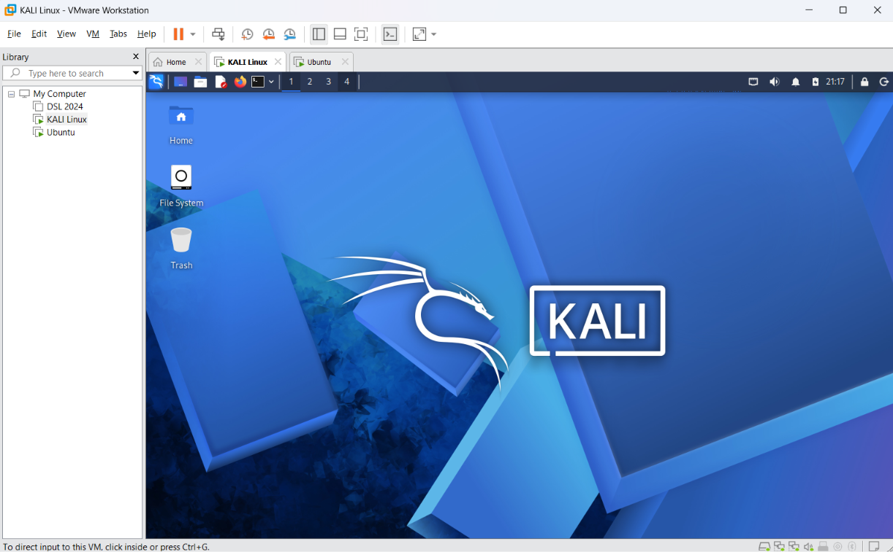

## 2. Network Interfaces

I used `ip addr` on both machines to identify their network interfaces and IP addresses.

### Kali Linux

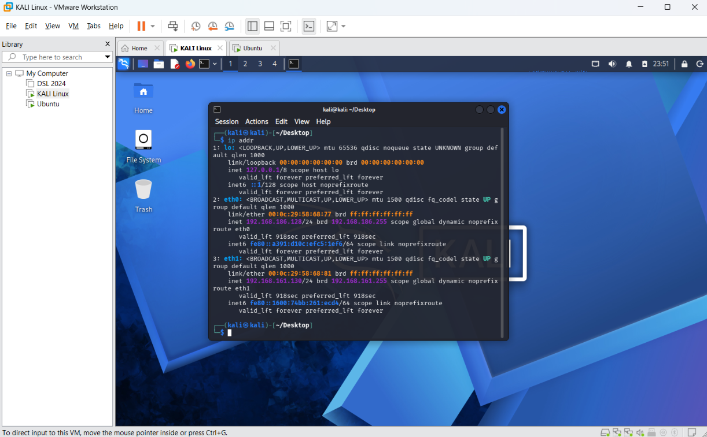

### Ubuntu

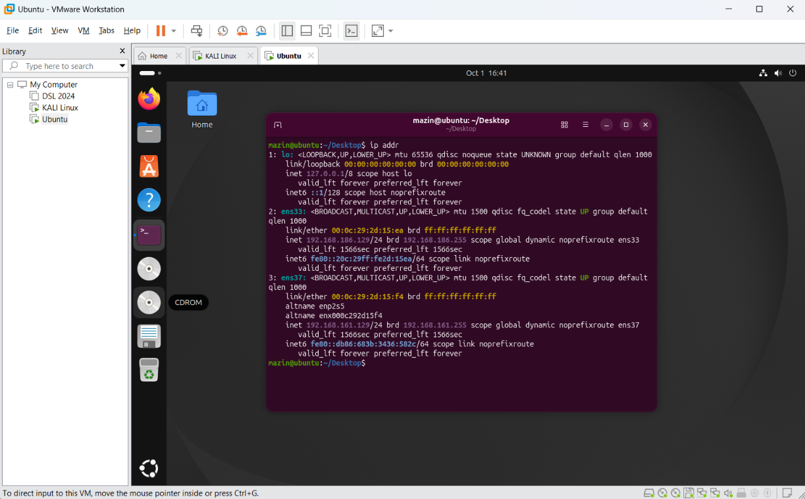

## 3. Testing Network Connectivity

I used the `ping` command to make sure Kali and Ubuntu could communicate with each other.

### Kali to Ubuntu

### Ubuntu to Kali

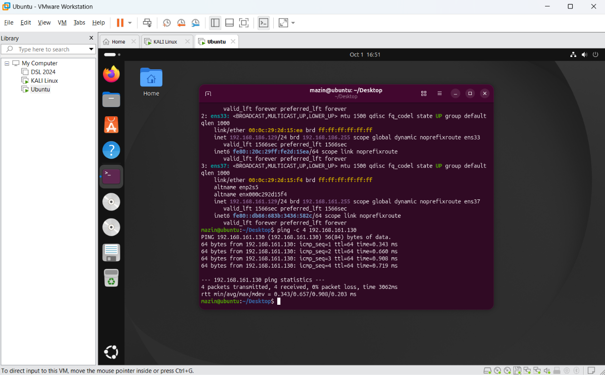

The successful replies and 0% packet loss confirmed that the two virtual machines could communicate.

## 4. Nmap Scanning

I used Nmap to scan between the two machines and see which ports were available.

### Kali scanning Ubuntu

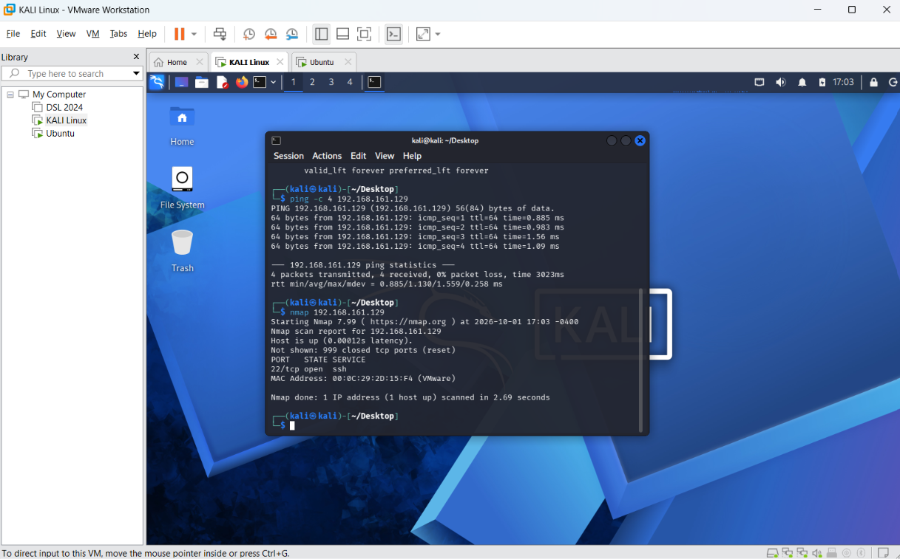

### Ubuntu scanning Kali

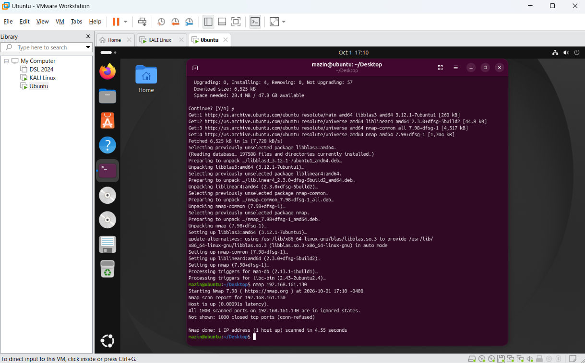

One of the results showed TCP port 22 open, which is used by SSH.

## 5. SSH Remote Connection

I connected from Kali Linux to Ubuntu using SSH.

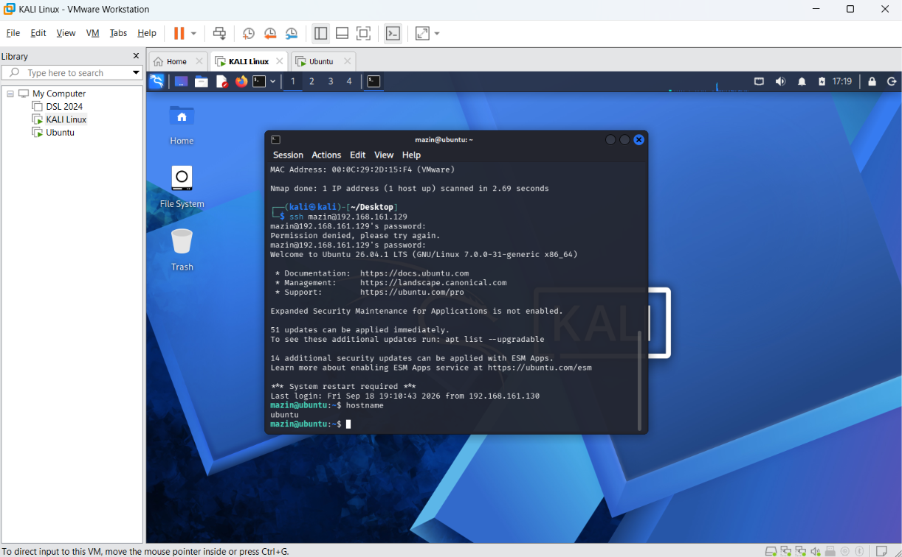

After connecting, I used `hostname` to verify that I was controlling the Ubuntu machine through the Kali terminal.

## 6. Secure File Transfer with SCP

I created a text file on Kali Linux:

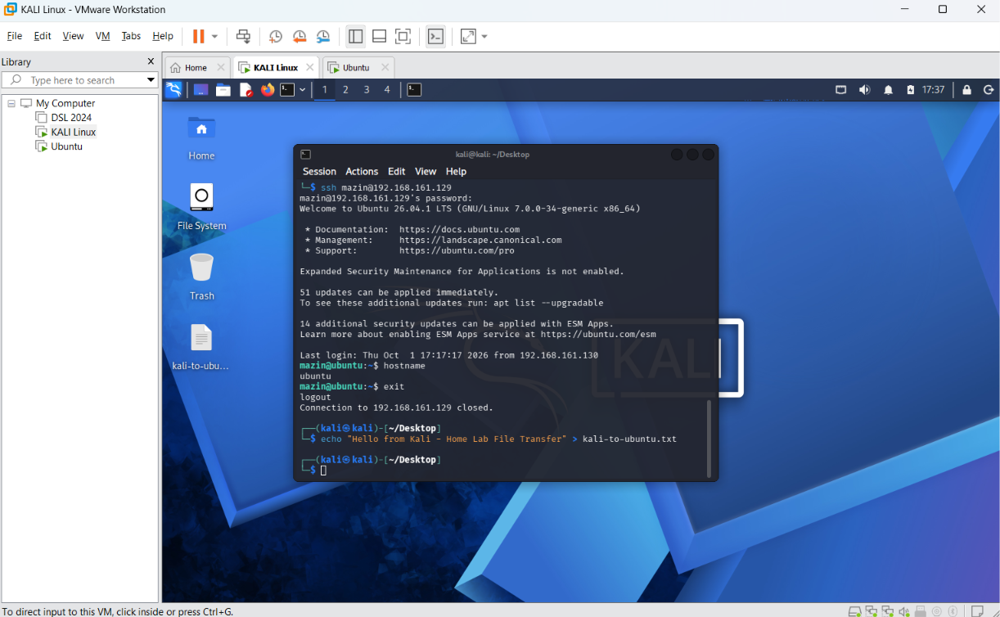

I then used SCP to securely transfer the file from Kali to Ubuntu.

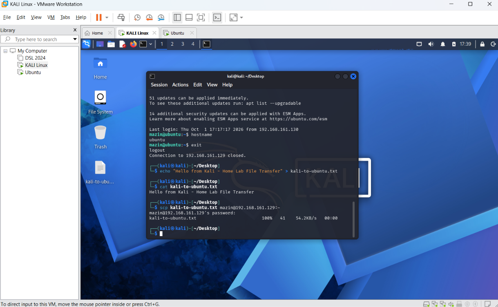

I verified the file contents on both systems.

### Kali

### Ubuntu

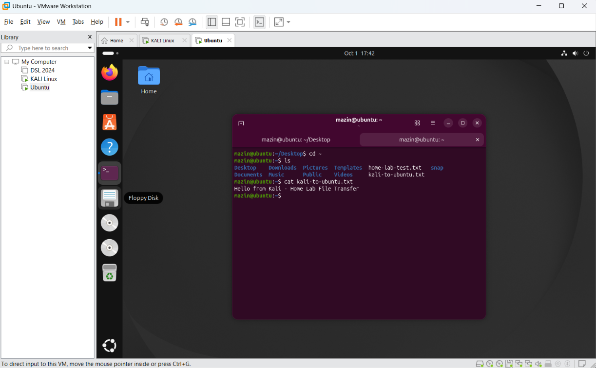

This confirmed that the file was successfully transferred between the two virtual machines.

## 7. Viewing Listening Ports

On Ubuntu, I used:

`sudo ss -tulpn`

This allowed me to view listening TCP and UDP ports and the services associated with them.

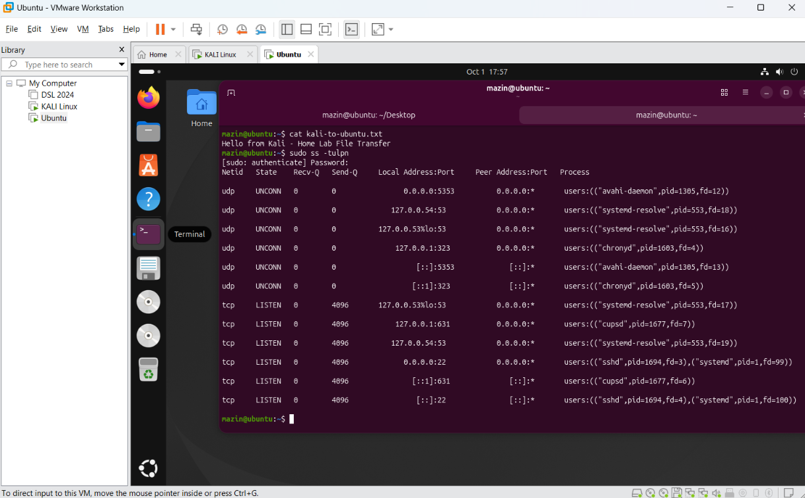

I was able to identify SSH listening on TCP port 22.

## 8. Disabling and Re-enabling SSH

I stopped the SSH service and socket on Ubuntu and then used Nmap from Kali to see how the scan changed.

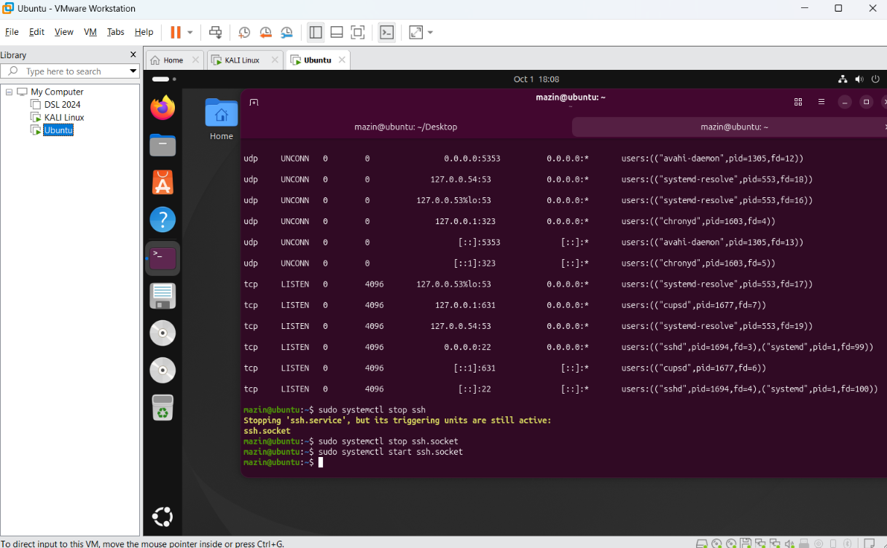

The scan showed port 22 closed while SSH was disabled. After starting SSH again, another Nmap scan showed port 22 open.

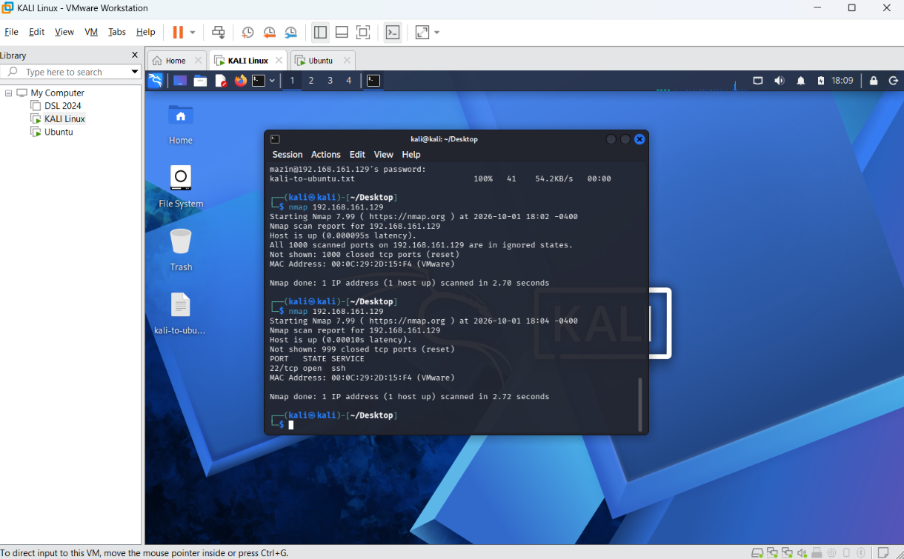

This helped me understand how running services directly affect which ports are accessible on a system.

## Commands Practiced

- `ip addr` — view network interfaces and IP addresses
- `ping` — test connectivity between systems
- `nmap` — scan a system for open ports
- `ssh` — remotely connect to another Linux system
- `scp` — securely transfer files between systems
- `cat` — display the contents of a file
- `hostname` — display the name of the current system
- `ss -tulpn` — view listening ports and services
- `systemctl` — start and stop Linux services

## What I Learned

This project gave me hands-on experience with Linux networking and communication between systems. I learned how to test connectivity, scan for open ports, remotely access another machine using SSH, securely transfer files with SCP, and see how enabling or disabling a service changes the system's network exposure.

## Security Note

This lab was performed only on virtual machines that I own and control in an isolated home lab environment. The `192.168.x.x` addresses shown in the screenshots are private IP addresses used inside the local lab network.
